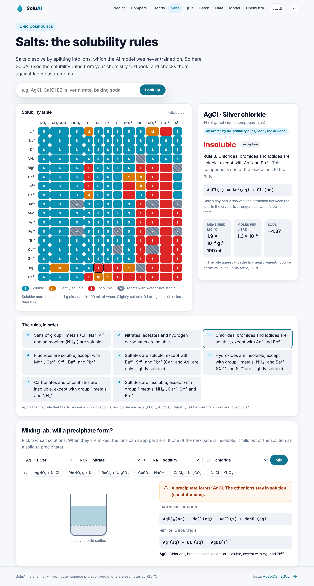
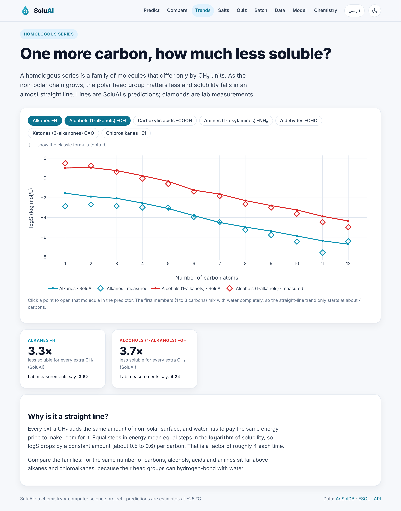

# SoluAI 💧: will it dissolve in water?

**SoluAI predicts how well an organic molecule dissolves in water, and explains *why* in
chemistry terms.** Type a name (`caffeine`, `کافئین`), a SMILES string (`CCO`), draw the molecule or pick one. You get:

* the predicted solubility (logS in mol/L, and g/L) with a **90% confidence range**;
* a solubility class on a colour scale (highly soluble → insoluble);
* the 2D structure with **atoms coloured by how they affect solubility** (blue = helps, red = hurts);
* a plain-language explanation, e.g. *"The five –OH groups increase solubility because they form
  hydrogen bonds with water."*;
* a warning when the molecule is **outside the model's experience**;
* the **lab value** (if known) and the **classic 2004 formula** next to the AI's answer;
* everyday units: grams in a glass of water, and how many litres you need to dissolve 1 g.

Around the model there is a small chemistry toolkit ([details](docs/features.md)):

| | |
|---|---|
| **Draw** a molecule, or type one of 225 offline names (English or Persian) | **Salts:** NaCl, AgCl, CaCO₃… answered with the textbook solubility rules, plus a "will a precipitate form?" mixing lab |
| **Make it more soluble:** the model tries small edits and ranks them | **Trends:** solubility along seven homologous series, prediction vs lab |
| **Quiz:** which one dissolves better? 4 levels, pick your AI opponent, leaderboard of every model | **Batch:** up to 200 molecules from a list or CSV, results as CSV |
| **Persian / English** interface with right-to-left layout | **Works offline** and prints a one-page PDF report |

It is a real, trained machine-learning model (LightGBM gradient boosting on RDKit descriptors and
Morgan fingerprints), trained on 8,754 measured molecules from AqSolDB. It is **not** an LLM.

> **Live site:** <https://soluai.onrender.com>
>
> A chemistry × computer science project. The [presentation guide](docs/presentation_guide.md)
> has a 6-minute talk outline, demo molecules and likely questions.


| Compare | Explore the data |
|---|---|
|  |  |
| **How the model works** | **Dark mode** |
|  |  |
| **Salts and the mixing lab** | **Trends** |
|  |  |
| **Quiz** | **Persian (فارسی)** |
|  |  |

## Quick start

Requires **Python 3.11–3.13** (Windows, macOS or Linux).

```bash
git clone https://github.com/RootedMani/soluai.git && cd soluai
```
```bash
python -m venv .venv && source .venv/bin/activate      # Windows: .venv\Scripts\activate
```
```bash
pip install -r requirements.txt
```
```bash
python run.py
```

This starts the site and opens <http://127.0.0.1:8000> in your browser (same as `uvicorn web.main:app`).
The trained model is included, so no training is needed. **No internet is needed either**: fonts,
charts and the drawing editor are bundled. Only looking up unusual molecule names uses PubChem.

**Retrain everything** (about 30 minutes, fully reproducible):

```bash
pip install -r requirements-dev.txt && pip install -e .
```
```bash
python -m soluai.train --config config.yaml
```

**Run the tests:**

```bash
pytest
```

**Put it online:** see [docs/deployment.md](docs/deployment.md). Deploying on Render takes a few
clicks with the included `render.yaml`.

## Results

Test-set scores. The test molecules were hidden during training and tuning and used only once.
RMSE and MAE are in log units: 1.0 means "off by a factor of 10". R² = share of the variation explained.

| Dataset · split | Delaney equation (2004) | Linear regression | Random forest | **LightGBM** |
|---|---|---|---|---|
| AqSolDB · random | 1.35 / 0.65 | 1.31 / 0.67 | 0.88 / 0.85 | **0.84 / 0.87** |
| AqSolDB · scaffold | 1.44 / 0.57 | 1.41 / 0.59 | 1.07 / 0.76 | **1.01 / 0.79** |
| ESOL · random | 1.07 / 0.70 | 0.89 / 0.79 | 0.62 / 0.90 | **0.61 / 0.90** |
| ESOL · scaffold | 1.24 / 0.64 | 1.21 / 0.66 | 0.81 / 0.85 | **0.83 / 0.84** |

Each cell is test RMSE / R². Random forest and LightGBM use descriptors + fingerprint; linear
regression uses the descriptors. Models were chosen by cross-validation, not by test score. Full
tables, including descriptor-only and fingerprint-only models and CV scores, are in
[results/metrics.md](results/metrics.md).

**What this shows**

* Machine learning cuts the error of the chemist's hand-made formula by 30–43% (RMSE).
* **New ring skeletons are harder** (scaffold split): the error rises from 0.84 to 1.01 on AqSolDB.
  The random split flatters every model.
* **Descriptors carry the big physical trends.** Fingerprints alone are clearly worse; combining
  both is best by cross-validation. On the small ESOL scaffold test, random forest happened to score
  slightly better than the CV-chosen LightGBM (0.81 vs 0.83). With about 230 test molecules that
  difference is within noise.
* The model **rediscovered textbook chemistry**: logP is its most important feature and pushes
  solubility down, while polar surface area and H-bond donors push it up
  ([details](docs/chemistry.md#8-how-this-connects-to-soluai)).
* **Honest caveats:** the 90% range covered 87–89% of test molecules (slightly under target). The
  "unfamiliar molecule" warning is only a weak signal. A good part of the remaining error is noise
  in the measurements themselves. See the [model card](docs/model_card.md) for limitations and
  real failure cases.


### Version 2: choose your model (model zoo)

Version 2 merged 13 public data sources (28,714 measurements, 8,589 molecules) and trained five
different kinds of model. The website lets you **choose which model answers** (Predict, Compare,
Trends, Batch, Quiz) and shows **what every model predicts** for the same molecule. When the models
agree, trust the number more; when they disagree, less.

| Model (same 1,718 unseen test molecules) | Random split R² / RMSE | Scaffold split R² / RMSE |
|---|---|---|
| **SoluAI v2 · consensus** (default; blends the five below) | **0.89 / 0.78** | **0.85 / 0.97** |
| Gradient boosting (LightGBM) | 0.88 / 0.79 | 0.84 / 1.00 |
| Robust boosting (Huber loss) | 0.88 / 0.80 | 0.84 / 1.00 |
| CatBoost | 0.88 / 0.80 | 0.84 / 1.00 |
| Neural network | 0.87 / 0.83 | 0.83 / 1.03 |
| Similarity model (SVR) | 0.86 / 0.87 | 0.82 / 1.06 |
| SoluAI v1.0 recipe | 0.87 / 0.84 | 0.82 / 1.05 |
| Delaney's formula | 0.68 / 1.30 | 0.63 / 1.53 |

Two labs measuring the same molecule agree only at R² ≈ 0.86, which limits every model. The
atom-by-atom "Why?" explanation always comes from SoluAI v1.0 (the only model with exact SHAP
values); the page says so when another model is chosen. Code: `src/soluai/zoo.py`; training:
`python -m soluai.train_zoo`; the experiment behind it: [experiments/v2-consensus-stacking](experiments/v2-consensus-stacking/README.md).
## Project structure

```
soluai/
├── config.yaml              all training settings (seed, splits, search space)
├── data/raw/                original datasets + SOURCES.md (URLs, citations, licenses, checksums)
├── data/processed/          cleaned datasets + cleaning report
├── src/soluai/              the Python package
│   ├── data.py              download, clean, canonicalise
│   ├── features.py          RDKit descriptors + Morgan fingerprints
│   ├── splits.py            random split, scaffold split, CV folds
│   ├── baselines.py         Delaney's ESOL equation
│   ├── models.py            linear / random forest / LightGBM factories
│   ├── train.py             one-command training + evaluation
│   ├── evaluate.py          RMSE, MAE, R²
│   ├── uncertainty.py       conformal 90% range + similarity check
│   ├── explain.py           SHAP → atom colours + plain-language sentences
│   ├── groups.py            functional groups (SMARTS)
│   ├── predict.py           load model, predict
│   ├── resolve.py           name/SMILES → molecule, friendly errors, PubChem
│   ├── common_molecules.py  offline list of 225 molecules, with Persian names
│   ├── ionic.py             salts: solubility rules, equations, mixing two solutions
│   └── lab.py               series, "make it more soluble", quiz, batch, kitchen test
├── models/soluai-v1.0.0/    trained model + metadata (versioned)
├── results/                 metrics tables and data for the website
├── web/                     FastAPI server (main.py) + HTML/CSS/JS pages (static/)
│   └── static/vendor/       bundled Plotly, JSME editor and fonts (see THIRD-PARTY.md)
├── run.py                   start the site locally and open the browser
├── notebooks/               01_soluai_story.ipynb: the story with charts
├── docs/                    chemistry, model, model card, presentation guide, deployment
├── tests/                   pytest unit tests
└── render.yaml              one-click deployment on Render
```

## Documentation

* [docs/chemistry.md](docs/chemistry.md): the chemistry of solubility, for high school students
* [docs/features.md](docs/features.md): the tools around the model (salts, trends, quiz, batch, Persian, offline)
* [docs/model.md](docs/model.md): the ML pipeline step by step in simple language
* [docs/model_card.md](docs/model_card.md): intended use, metrics, limitations, failure cases
* [docs/presentation_guide.md](docs/presentation_guide.md): 6-minute talk, demo plan, Q&A
* [docs/deployment.md](docs/deployment.md): putting the website online
* The two Persian PDFs below describe version 1.0 (before the tools in docs/features.md were added).
* [docs/soluai-documentation-fa.pdf](docs/soluai-documentation-fa.pdf): project documentation in Persian, for teachers (مستندات پروژه)
* [docs/soluai-guide-fa.pdf](docs/soluai-guide-fa.pdf): complete guide in Persian (راهنمای کامل پروژه به فارسی)

## Data and credits

* **AqSolDB:** Sorkun, Khetan & Er (2019), *Scientific Data* 6:143, [doi:10.1038/s41597-019-0151-1](https://doi.org/10.1038/s41597-019-0151-1). CC0.
* **ESOL:** Delaney (2004), *J. Chem. Inf. Comput. Sci.* 44:1000–1005, [doi:10.1021/ci034243x](https://doi.org/10.1021/ci034243x), via MoleculeNet/DeepChem.
* **Salt solubilities:** g/100 mL at 20 °C from the Wikipedia [Solubility table](https://en.wikipedia.org/wiki/Solubility_table) (CC BY-SA), which collects handbook values.
* Bundled: [JSME](https://jsme-editor.github.io/) molecule editor (BSD-3), Inter, JetBrains Mono and Vazirmatn fonts (OFL). See [THIRD-PARTY.md](web/static/vendor/THIRD-PARTY.md).
* Built with [RDKit](https://www.rdkit.org), [LightGBM](https://lightgbm.readthedocs.io), [scikit-learn](https://scikit-learn.org), [FastAPI](https://fastapi.tiangolo.com) and [Plotly.js](https://plotly.com/javascript/) (bundled, MIT).

Code: MIT license. Datasets: see [data/raw/SOURCES.md](data/raw/SOURCES.md).
